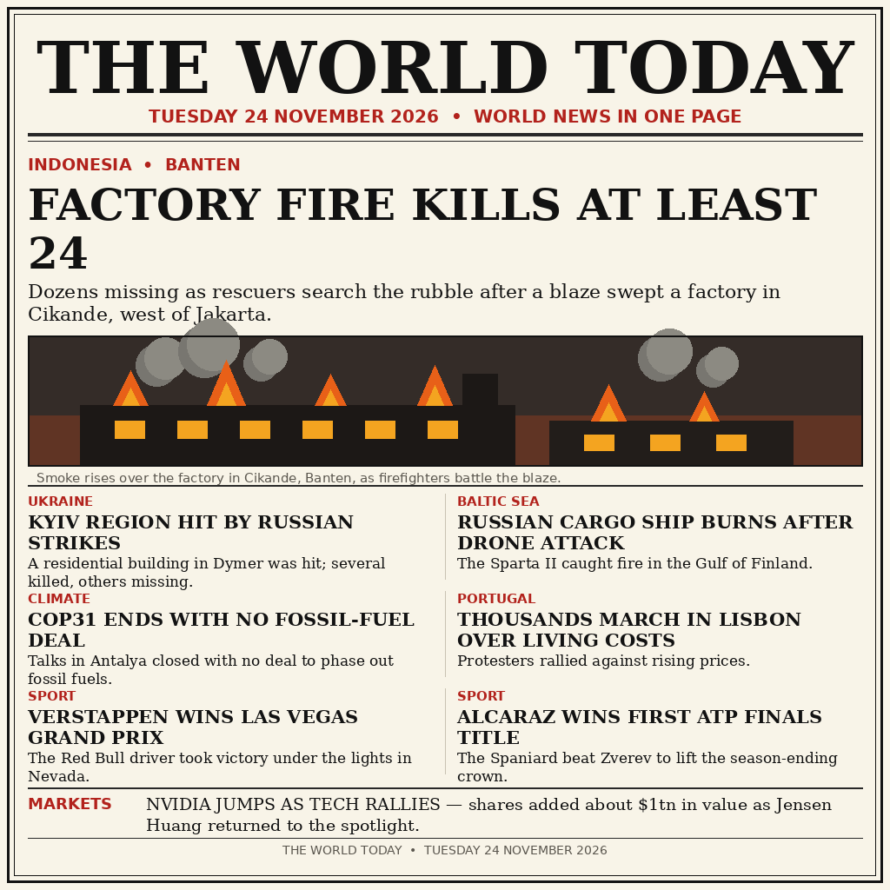

# THE WORLD TODAY — Tuesday 24 November 2026

[](https://make.fun/bounty/news-image-20261124)
[](https://make.fun/bounty/news-image-20261124)
[](https://make.fun/bounty/news-image-20261124)

A front-page newspaper that sums up the world news of Tuesday 24 November 2026 in one image — built for the [$100 bounty on make.fun](https://make.fun/bounty/news-image-20261124).

## The day's news

- **Indonesia:** a factory fire in Cikande, Banten, killed at least 24 people, with dozens missing as rescuers search the rubble.
- **Ukraine:** Russian strikes hit the Kyiv region; a residential building in Dymer was hit, several killed, others missing.
- **Baltic Sea:** the Russian cargo ship Sparta II caught fire in the Gulf of Finland after a drone attack.
- **Climate:** COP31 talks in Antalya ended with no deal on phasing out fossil fuels.
- **Portugal:** thousands marched in Lisbon over the rising cost of living.
- **Sport:** Max Verstappen won the Las Vegas Grand Prix; Carlos Alcaraz won his first ATP Finals title, beating Zverev.
- **Markets:** Nvidia jumped as tech rallied, adding about $1tn in value as Jensen Huang returned to the spotlight.

## How it works

`main.py` (Python 3.13, standard library + Pillow) draws the 1024×1024 front page programmatically and writes it to `entry.png`, then copies it to `/output/entry.png`. No network, no randomness, no clock — two runs write identical bytes.

```sh
python3 main.py
```

## Entry


